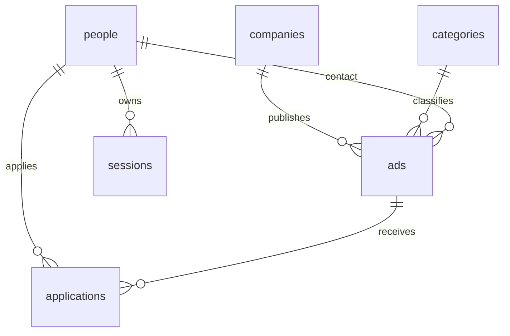

# HireLoop — Job Board

A complete application built from the **Job Board Bootstrap** and **Job Board Project** assignments: a JavaScript frontend, a Python REST API, and a persistent SQLite relational database.

## Update of November 5, 2026 — French / English

- Added a **FR / EN** switcher on the right side of the navigation bar, after the account buttons.
- French remains the default language. The language choice is saved in the browser (`localStorage`) when available.
- Interface text is translated: navigation, search and filters, forms, profile, applications, administration, notifications, and listed error messages.
- Switching languages happens without reloading the page and keeps entered fields and filter values.
- Displayed dates are adapted to the selected language. Job titles and descriptions, as well as text written by recruiters, stay in their original language.
- The FR / EN controls announce the active language to assistive technologies; the document language is also updated.

**Candidate role:** the two demo accounts, Camille and Alex, have the same technical role `candidate` and the same permissions. In French, "Candidate" and "Candidat" are the feminine and masculine forms of the same role; in English, both are shown as "Candidate".

## Fixes of November 5, 2026

- **First launch on a new database:** the demo data was inserted twice, which crashed the server with `UNIQUE constraint failed: people.email`. `seed.py` now inserts it once, so a fresh install starts on the first try.
- **API tests:** the same crash stopped the whole suite during setup. All 10 tests now run and pass.
- **Migration test:** `test_08` no longer matched the reformatted `schema.sql`, so it never built an old-style database. It now creates a real one and checks that the upgrade keeps existing data.
- **Demo company account:** `company@test.com` was documented but missing from new databases. It is now part of the demo data, attached to Studio North, and covered by a test.
- **README:** this English file is now the project's only README.

## Get started in 30 seconds

Requirement: **Python 3.10 or later**. No library installation, no npm, no API key, and no Internet connection needed.

From the `jobboard` folder:

```sh
python server.py
```

On Windows, you can also double-click **`run.cmd`**. The launcher looks for `py`, then the Python bundled with Codex if present, then `python`.

Open **http://127.0.0.1:8000**. Keep the terminal open; `Ctrl+C` stops the server.

Different port:

```sh
python server.py --port 8080
```

The database is automatically created in `data/hireloop.sqlite3`, then populated **by the backend** only on first launch. Changes persist across restarts.

### Demo accounts

| Access | Email | Password |
|---|---|---|
| Administrator | `admin@hireloop.test` | `Admin2026!` |
| Candidate (Camille) | `camille@hireloop.test` | `Camille2026!` |
| Candidate (Alex) | `alex@hireloop.test` | `Alex2026!` |
| Company | `company@test.com` | `Company123!` |

All companies, job ads, and people are **fictional**. The initial data contains 6 companies, 6 categories, 12 job ads, 4 people, and 3 applications.

## Features

- Paginated job ads, search by job title/keyword/company, filters by city, field, contract type, and work arrangement; sorting by relevance, date, or salary.
- Each ad shows a title, a summary, the conditions, a **Learn more** button, and an **Apply** button.
- Full details loaded with `fetch()`, without reloading the document and without a popup. URL fragments such as `#job/1` make views shareable and compatible with the Back button.
- Anonymous application (name, email, phone, message) or with an account: account details are reused automatically.
- The message, date, job ad, candidate, and status are stored. Duplicate applications are rejected.
- Sign-up, login, logout, profile and password editing; personal tracking of applications.
- Redirect after login: administrators go to the admin area, candidates go to the job ads.
- Server-side protected administration: view, create, edit, and delete **job ads, companies, categories, people, and applications**. Forms with reference dropdowns and paginated tables.
- Application status updates: received, in progress, interview, accepted, or rejected.
- Responsive bilingual French / English interface, keyboard navigation, form labels, empty states, built-in errors and confirmations.

**Receiving applications:** messages are stored in SQLite and visible in the Applications tab of the admin area. There is no SMTP sending and no simulated email sending; `email_status = Enregistré` ("Saved") only indicates that the message was stored. The assignment does not require a CV, and no file upload is implemented.

## Architecture

```text
jobboard/
  server.py              HTTP server, API, validation, and authentication
  schema.sql             Tables, foreign keys, constraints, and indexes
  seed.py                Fictional data inserted by the backend
  run.cmd                Windows launcher
  public/
    index.html           HTML structure and navigation
    style.css            Visual identity and responsive layout
    app.js               Views, fetch, forms, and administration
    i18n.js              FR/EN translations and language preference
    favicon.svg          Local icon
  tests/test_api.py      HTTP integration tests on a temporary database
  tests/test_i18n.cjs    Translation and input-preservation tests
  docs/queries.sql       The three SQL queries from the bootstrap
  docs/VALIDATION.md     Checks and demo walkthrough
  data/                  Local database and logs, excluded from the source deliverable
```

The browser communicates exclusively with `/api`. The server uses the Python standard library (`http.server`, `sqlite3`, `hashlib`). SQLite is a real SQL database with joins, constraints, transactions, and on-disk storage. The same origin serves both the API and the static assets.

### Relational schema



| Table | Main fields |
|---|---|
| `companies` | name, industry, city, website, description, color |
| `categories` | unique name |
| `people` | name, unique email, phone, optional hashed password, role |
| `ads` | company, category, contact, title, summary, description, profile, city, contract, work arrangement, salaries, schedule, featured flag, date |
| `applications` | ad, person, message, status, storage trace, date; unique per person/ad |
| `sessions` | token hash, person, expiration |

An anonymous application creates a person without a password. An email address tied to an account requires logging in, to prevent impersonation. Creating an account with an already known address is rejected; password recovery and email verification are not part of this local version.

Deleting a job ad or a person deletes its applications by cascade. Deleting a company, category, or person still referenced as an ad's contact is rejected (`409`). The last administrator is protected, and administrators cannot delete their own account. The technical `sessions` table is not exposed through CRUD, to avoid leaking tokens.

## REST API

All routes are prefixed with **`/api`**. Request bodies are JSON with `Content-Type: application/json`. Error responses have the form `{"error":"Explanation"}`. Lists are generally `{items,total,page,limit}`; pagination `?page=1&limit=6`, maximum limit 100.

### Public and account routes

| Method | Route | Purpose |
|---|---|---|
| GET | `/health` | API and SQLite availability |
| GET | `/ads` | Filtered, paginated job ads |
| GET | `/ads/:id` | Full details of a job ad |
| GET | `/companies/:id/ads` | A company's job ads |
| GET | `/meta` | Companies (ID/name), categories, and cities for filters |
| GET | `/stats` | Number of job ads, companies, people, and applications |
| POST | `/ads/:id/applications` | Apply, with or without a session |
| POST | `/auth/register` | Create a candidate account and open a session |
| POST | `/auth/login` | Open a session |
| POST | `/auth/logout` | Revoke the session |
| GET | `/auth/me` | Current account or `null` |
| PATCH | `/account` | Edit own profile (session required) |
| GET | `/my-applications` | Own applications only (session required) |

`/ads` filters: `q`, `location`, `category_id`, `company_id`, `contract`, `work_mode`. Sorting: `sort=relevant`, `sort=recent`, `sort=salary`. Filters are combined with AND; text search uses SQLite `LIKE` (accent matching follows native SQLite behavior).

### Admin CRUD

For each of the resources **`companies`, `categories`, `people`, `ads`, `applications`**:

| Method | Route | Purpose |
|---|---|---|
| GET | `/:resource` | Paginated list |
| GET | `/:resource/:id` | Read a record |
| POST | `/:resource` | Create a record |
| PATCH | `/:resource/:id` | Update the provided fields |
| PUT | `/:resource/:id` | Update with all required fields |
| DELETE | `/:resource/:id` | Delete a record |

Exception: viewing job ads remains public. All other CRUD operations require an administrator session, even when the URL is entered directly. People lists never return password hashes.

Writable fields: see `RESOURCES` and `REQUIRED` in `server.py`, as well as `schema.sql`. `id` and `created_at` are managed by the server. An optional password can be sent through the people CRUD; an account without a password cannot log in.

### curl examples

In PowerShell, use `curl.exe` if `curl` refers to a PowerShell command. These examples are written for a POSIX terminal; you can also use Postman or Insomnia with the same JSON bodies.

```sh
curl 'http://127.0.0.1:8000/api/ads?contract=CDI&location=Paris'
curl http://127.0.0.1:8000/api/ads/1
curl http://127.0.0.1:8000/api/companies/1/ads

curl -c cookies.txt -H 'Content-Type: application/json' \
  -d '{"email":"admin@hireloop.test","password":"Admin2026!"}' \
  http://127.0.0.1:8000/api/auth/login

curl -b cookies.txt -H 'Content-Type: application/json' \
  -d '{"company_id":1,"category_id":1,"contact_id":1,"title":"Développeur Python","summary":"Rejoignez notre équipe.","description":"Construire et maintenir notre API.","requirements":"Python et SQL.","location":"Paris","contract":"CDI","work_mode":"Hybride","salary_min":40000,"salary_max":50000}' \
  http://127.0.0.1:8000/api/ads

curl -H 'Content-Type: application/json' \
  -d '{"name":"Test Local","email":"test@example.test","phone":"0601020304","message":"Bonjour, je souhaite rejoindre votre équipe et contribuer à ce projet."}' \
  http://127.0.0.1:8000/api/ads/1/applications
```

Status codes: `200` success; `201` created; `400` invalid data; `401` missing session/wrong credentials; `403` admin access denied/invalid origin; `404` resource not found; `405` method not allowed; `409` duplicate/blocking relation; `413` body too large; `415` wrong content type; `429` too many login attempts.

## Tests and demo

```sh
python -m unittest discover -s tests -v
```

The tests start a server on a free port with a database in a temporary folder; they do not modify the demo data. Ten tests cover more than 100 HTTP requests: filters, pagination, anonymous/candidate permissions, accounts, applications, validation, CRUD on all five resources, constraints, and request origin.

### Translation tests

With **Node.js 18 or later**, no dependency installation needed:

```sh
node --test tests/test_i18n.cjs
```

The five tests check the default language and saved preference, dynamic text and dates, switching back to French, the exclusion of free-form content, and the translation of accessibility attributes without altering field values. Node.js is only needed for these tests, not for running the site.

See `docs/VALIDATION.md` for the presentation walkthrough. The three SQL queries required by the bootstrap are in `docs/queries.sql`.

## Configuration and deployment limits

- `JOBBOARD_DB`: alternative SQLite database path. PowerShell example: `$env:JOBBOARD_DB='C:\temp\hireloop.sqlite3'` before starting.
- `--host`: listening address, `127.0.0.1` by default. The project is delivered for local execution.
- `COOKIE_SECURE=1`: adds the Secure attribute to cookies for an installation behind HTTPS; do not enable over local HTTP.
- PBKDF2-HMAC-SHA256 passwords (260,000 iterations and a random salt), random session tokens stored as SHA-256 hashes, HttpOnly/SameSite=Lax cookies, 24-hour expiration, parameterized SQL queries, origin checks, field allowlist, and a CSP policy.
- Login is limited to 15 attempts per IP over five minutes. This in-memory limit resets on restart.
- The demo accounts and the standard-library HTTP server are intended for development and local evaluation. An Internet deployment requires a suitable server/reverse proxy, HTTPS, and replacing the demo accounts. Nothing is published externally.
- No SMTP, password recovery, email verification, CV storage, or automatic collection of external job ads is configured. The detailed assignment is covered by job ad management in the admin area.

To start from scratch, stop the server, back up and then move `data/hireloop.sqlite3` (and any `-wal`/`-shm` files); a new demo database will be created on the next launch.

## Project and company administration

The `admin` role administers the entire project. The `company_admin` role is tied to a company via `company_id`: it can edit its company profile, create/edit/delete its job ads, and view received applications with candidates' contact details, then change their status. It cannot manage accounts, roles, or categories. These checks are enforced in the API, including on direct access by ID. Public job ads remain visible to everyone.

To assign this role: log in as the project administrator, open **Administration → People**, create or edit an account, choose **Company administrator**, select its company, and save. For a new account, set a password so it can log in. Several administrators can be attached to the same company.

Restart the server after updating: the existing database is migrated automatically, keeping accounts, IDs, and relationships. The existing administrator keeps global access.
