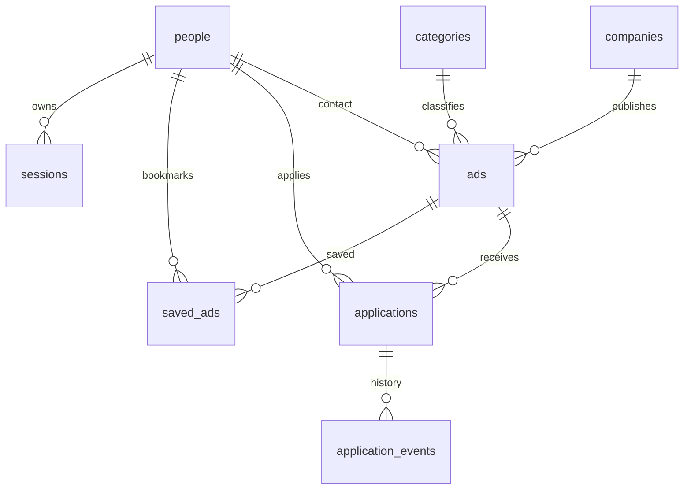

# HireLoop — Job Board

A complete job board built from the **Job Board Bootstrap** and **Job Board Project** assignments: a JavaScript frontend, a Python REST API and a persistent SQLite database. No dependencies, no build step.

Every listing shows its salary range, contract and remote policy. Candidates apply with their profile and follow each step of their applications. Recruiters manage their company's jobs and move applications through a pipeline. The project administrator manages everything.

## Get started in 30 seconds

Requirement: **Python 3.10 or later**. No library installation, no npm, no API key and no Internet connection needed.

From the `jobboard` folder:

```sh
python server.py
```

On Windows you can also double-click **`run.cmd`**. Open **http://127.0.0.1:8000** and keep the terminal open; `Ctrl+C` stops the server. Use `python server.py --port 8080` for another port.

The database is created in `data/hireloop.sqlite3` and filled with demo data on first launch. An existing database from an earlier version is **upgraded automatically** on start: accounts, IDs and relationships are kept, existing ads become "published" and every existing application gets its first history entry.

### Demo accounts

| Access | Email | Password |
|---|---|---|
| Project administrator | `admin@hireloop.test` | `Admin2026!` |
| Recruiter at Studio North (Inès Moreau) | `company@test.com` | `Company123!` |
| Candidate (Camille) | `camille@hireloop.test` | `Camille2026!` |
| Candidate (Alex) | `alex@hireloop.test` | `Alex2026!` |

The sign-in page lists these accounts with a **Use** button that signs in directly. All companies, jobs and people are **fictional**. The demo data has 6 companies, 6 categories, 14 jobs (12 published, 1 draft, 1 closed), 8 people (4 extra applicants without a password) and 10 applications with their status history.

## What's in it

### For candidates

- Search by keyword (title, summary, company or field), city, contract, work arrangement, field and minimum salary. Sort by relevance, date or salary. Filters are kept in the address (`#jobs?q=react&contract=CDI`), so a search can be shared or refreshed. On phones, filters open as a bottom sheet.
- Job pages with the full description, requirements as a list, an "at a glance" panel, the company, and similar jobs.
- **Save jobs** with the bookmark icon and find them under *Saved jobs*.
- **Apply** with a message (20 characters minimum, with a live counter). Name, email and phone come from the profile. The draft message is kept in the browser until it is sent. Visitors who are not signed in are invited to sign in or register, then return to the same job.
- **Track applications**: a stepper (Received → In progress → Interview → Decision) that only marks steps really reached, the status history, the message sent, and a "New" badge when a recruiter changes a status. An application can be **withdrawn** until it receives a decision.
- Profile with headline, city, portfolio link and bio, with a completion meter. Password change, and **account deletion** (password required).

### For recruiters (`company_admin`)

- **Dashboard**: published, draft and closed jobs, applications this week, applications waiting for a reply, job views, a 14-day chart, the status breakdown, latest applications, and the most followed jobs.
- **Jobs**: tabs by status with counts, search, quick **Publish / Close / Reopen** actions, and an editor in a side panel. A job can be kept as a **draft** (only the team can see and preview it), **published**, or **closed** (still visible, but no new applications). Publishing a draft dates it from that day.
- **Applications**: tabs by status with counts, filter by job, search by name or email, a status selector on each row, and **CSV export** (opens in Excel, accents included). The detail panel shows the candidate's profile and contact links, the message, a status picker, **private notes** (never shown to the candidate) and the full history with who changed what.
- **Company profile** with a live preview of how it appears on job pages.

Recruiters only see their own company's jobs, applications and applicants. This is enforced by the API, including direct access by ID. They cannot feature their own jobs, and new jobs automatically belong to their company with them as the contact.

### For the project administrator (`admin`)

Everything above for every company, plus **Companies**, **Categories** and **Users**. In Users you can filter by role, see the last sign-in, create accounts, assign the Recruiter role and its company, and reset passwords. Only the administrator can feature a job on the home page. The last administrator cannot be removed or demoted.

### Interface

- Bilingual **French / English** switcher. French is the default; the choice is remembered, and `?lang=en` in the address forces a language. Switching does not reload the page and keeps what was typed. Job content written by recruiters stays in its original language.
- Responsive from phones (checked at 390 px wide) to wide screens, with no horizontal scrolling. Admin tables turn into stacked cards on phones, and the console sidebar becomes a scrollable tab bar.
- Keyboard-friendly: skip link, visible focus, a <kbd>Esc</kbd>-closable side panel and dialogs, labelled icon buttons, and `aria-current` on navigation.
- Confirmation dialogs for destructive actions, toasts with follow-up links, skeleton loading, and empty states that say what to do next.

**Receiving applications:** messages are stored in SQLite and appear in the recruiter's Applications screen. No email is sent. `email_status = Enregistré` ("Saved") only means the message was stored. There is no CV upload.

## Architecture

```text
jobboard/
  server.py              HTTP server, REST API, validation, permissions, migrations
  schema.sql             Tables, foreign keys, constraints and indexes
  seed.py                Fictional demo data, inserted only into an empty database
  run.cmd                Windows launcher
  public/
    index.html           Page shell: header, footer, script loading
    style.css            Design tokens, components, pages, responsive rules
    i18n.js              FR/EN catalogue and DOM translation
    js/core.js           API client, formatting, icons, toast, dialog, side panel
    js/jobs.js           Job search, job page and application form, companies
    js/account.js        Sign-in, registration, candidate space
    js/admin.js          Recruiter and administrator console
    js/main.js           Header, hash router, start-up
    favicon.svg          Local icon
  tests/test_api.py      HTTP integration tests on a temporary database
  tests/test_i18n.cjs    Translation tests
  docs/queries.sql       The three SQL queries from the bootstrap
  docs/VALIDATION.md     Checks and demo walkthrough
  data/                  Local database, excluded from the source deliverable
```

The browser talks to the server only through `/api`. The server uses the Python standard library (`http.server`, `sqlite3`, `hashlib`, `csv`). The frontend is plain ES modules with no framework or bundler. Views are addressed by URL fragments (`#job/1`, `#admin/applications/12`), so the Back button and shared links work.

### Relational schema



| Table | Main fields |
|---|---|
| `companies` | name, industry, city, website, description, colour |
| `categories` | unique name |
| `people` | name, unique email, phone, hashed password, role, company (recruiters), headline, city, bio, website, last sign-in |
| `ads` | company, category, contact, title, summary, description, requirements, city, contract, work arrangement, salaries, schedule, featured, **status** (`draft`/`published`/`closed`), **views**, dates |
| `applications` | ad, person, message, status, contact details frozen at the time of applying, **private notes**, date of the last status change; unique per person and ad |
| `application_events` | application, status, who made the change, date |
| `saved_ads` | person, ad, date; one row per pair |
| `sessions` | token hash, person, expiry |

Deleting an ad or a person deletes their applications, history and bookmarks by cascade. Deleting a company, category or person still referenced by an ad is refused (`409`). A recruiter who is still the contact of an ad must hand it over before deleting their account.

## REST API

All routes start with **`/api`**. Bodies are JSON with `Content-Type: application/json`. Errors look like `{"error":"Explanation"}`. Lists are `{items,total,page,limit}` with `?page=1&limit=6` (maximum 100).

### Public routes

| Method | Route | Purpose |
|---|---|---|
| GET | `/health` | API and SQLite availability |
| GET | `/ads` | Published ads. Filters: `q`, `location`, `category_id`, `company_id`, `contract`, `work_mode`, `min_salary`. Sort: `sort=relevant\|recent\|salary` |
| GET | `/ads/:id` | One ad (published or closed; drafts only for their team). Counts a view. When signed in, adds `viewer: {saved, application, can_manage}` |
| GET | `/ads/:id/similar` | Up to 3 published ads in the same field or company |
| GET | `/companies/:id/ads` | A company's published ads |
| GET | `/directory/companies` | Public company list with the number of open jobs |
| GET | `/directory/companies/:id` | Public company profile with its published ads |
| GET | `/meta` | Companies, categories with job counts, cities, contracts, work arrangements, statuses |
| GET | `/stats` | Published ads, hiring companies, applications, people |

### Account and candidate routes

| Method | Route | Purpose |
|---|---|---|
| POST | `/auth/register` | Create a candidate account and open a session |
| POST | `/auth/login` | Open a session |
| POST | `/auth/logout` | Close the session |
| GET | `/auth/me` | `{user, updates, saved}`: the account, the number of status updates not yet seen, the saved ad IDs |
| PATCH | `/account` | Edit own profile (`name`, `email`, `phone`, `headline`, `location`, `bio`, `website`, `password`). Email or password changes need `current_password` |
| DELETE | `/account` | Delete own account, with `{"current_password":...}` |
| POST | `/ads/:id/applications` | Apply with `{"message":...}` (candidate accounts only) |
| GET | `/my-applications` | Own applications with their history and an `updated` flag. Private notes are never included |
| POST | `/my-applications/seen` | Mark status updates as seen |
| DELETE | `/my-applications/:id` | Withdraw an application that has no decision yet |
| GET | `/saved` | Saved ads |
| PUT / DELETE | `/saved/:ad_id` | Save or unsave an ad |

### Administration

| Method | Route | Purpose |
|---|---|---|
| GET | `/admin/dashboard` | Figures for the dashboard, limited to the recruiter's company |
| GET | `/admin/stats` | Record counts within the admin's scope |
| GET | `/admin/applications/export` | CSV export (`?status=` and `?ad_id=` optional) |

CRUD on **`companies`, `categories`, `people`, `ads`, `applications`**: `GET /:resource`, `GET /:resource/:id`, `POST /:resource`, `PATCH` and `PUT /:resource/:id`, `DELETE /:resource/:id`. Prefix the routes with `/admin` to read the admin view of ads. Lists accept `q` (search) and exact filters: `status`, `company_id`, `category_id` and `contract` for ads; `status`, `ad_id` and `company_id` for applications; `role` and `company_id` for people. Ad and application lists also return `facets` (counts per status) for tabs. Records come with readable names (`company_name`, `ad_title`, `applications_count`…), so the interface never has to download whole tables to show names.

Reading published ads stays public. Every other CRUD operation requires an administrator or a recruiter, even when the URL is typed directly. People lists never return password hashes. Writable fields: see `RESOURCES` and `REQUIRED` in `server.py`. Text lengths, emails, phones, URLs, colours, contracts, statuses and roles are validated with clear messages.

### curl examples

In PowerShell, use `curl.exe`. These examples are written for a POSIX shell; Postman or Insomnia work with the same bodies.

```sh
curl 'http://127.0.0.1:8000/api/ads?contract=CDI&location=Paris&min_salary=45000'
curl http://127.0.0.1:8000/api/ads/1
curl http://127.0.0.1:8000/api/directory/companies/1

curl -c recruiter.txt -H 'Content-Type: application/json' \
  -d '{"email":"company@test.com","password":"Company123!"}' \
  http://127.0.0.1:8000/api/auth/login

# A recruiter's ad belongs to their company automatically; "draft" keeps it private.
curl -b recruiter.txt -H 'Content-Type: application/json' \
  -d '{"category_id":1,"title":"Développeur Python","summary":"Rejoignez notre équipe.","description":"Construire et maintenir notre API.","requirements":"Python\nSQL","location":"Paris","contract":"CDI","work_mode":"Hybride","salary_min":40000,"salary_max":50000,"status":"draft"}' \
  http://127.0.0.1:8000/api/ads

curl -b recruiter.txt -X PATCH -H 'Content-Type: application/json' \
  -d '{"status":"Entretien","notes":"Appel prévu jeudi."}' \
  http://127.0.0.1:8000/api/applications/1

curl -b recruiter.txt -o candidatures.csv http://127.0.0.1:8000/api/admin/applications/export
```

Status codes: `200` success; `201` created; `400` invalid data; `401` not signed in or wrong credentials; `403` not allowed or invalid origin; `404` not found; `405` method not allowed; `409` duplicate, blocking relation or closed ad; `413` body too large; `415` wrong content type; `429` too many attempts.

## Tests

```sh
python -m unittest discover -s tests -v
node --test tests/test_i18n.cjs
```

The API tests start a real server on a free port with a database in a temporary folder; they never touch the demo data. **22 tests** cover search and filters, pagination and sorting, anonymous, candidate, recruiter and admin permissions, accounts, applications, the job lifecycle and view counting, saved jobs, withdrawals, status history, private notes and the "updates" badge, admin search, filters and facets, the dashboard, CSV export, account deletion, the public company directory, validation, migrations, rate limits, robots.txt and the sitemap.

The **6 translation tests** (Node.js 18 or later, nothing to install) check the default language and the saved preference, templates and dates, that the catalogue has no malformed or duplicate lines, lossless switching, the exclusion of user content, and the translation of accessibility attributes. Node.js is only needed for these tests, not for running the site.

See `docs/VALIDATION.md` for the demo walkthrough. The three SQL queries required by the bootstrap are in `docs/queries.sql`.

## Security

- PBKDF2-HMAC-SHA256 passwords (260,000 iterations, random salt). Random session tokens are stored only as SHA-256 hashes. Cookies are HttpOnly and SameSite=Lax with a 24-hour expiry.
- Parameterised SQL everywhere; table and column names come from a fixed allowlist.
- Writes are refused when the `Origin` header points to another site. A strict Content Security Policy is applied; frames and MIME sniffing are blocked.
- CSV exports neutralise cells that spreadsheet software would run as formulas.
- Limits per visitor address: 15 failed logins in five minutes, 10 sign-ups per hour, 60 applications per hour, plus 20 applications per hour per account. Changing a password ends the account's other sessions; an admin reset ends all of them.

**Known limits:** email addresses are not verified, and there is no password recovery or email sending. Limits are kept in memory and reset on restart; people sharing one network share the per-address limits. The demo accounts have public passwords, so do not expose the project to the Internet as it is.

## Configuration

- `JOBBOARD_DB`: another SQLite path. PowerShell: `$env:JOBBOARD_DB='C:\temp\hireloop.sqlite3'`.
- `--host`: listening address, `127.0.0.1` by default.
- `COOKIE_SECURE=1`: adds the Secure attribute to cookies behind HTTPS.
- `TRUST_PROXY=1`: reads the visitor address from `X-Forwarded-For`. Only enable this behind a proxy that sets the header.
- `JOBBOARD_ENV=production` with `ADMIN_EMAIL` and `ADMIN_PASSWORD` (16 characters or more): no demo data; creates this administrator on first start.

To start from scratch, stop the server, then move `data/hireloop.sqlite3` (and any `-wal`/`-shm` files) elsewhere. A new demo database is created on the next launch.

## Search engines

The server generates `/robots.txt` and `/sitemap.xml` from the address the site is reached on. `robots.txt` blocks private API routes and leaves `/api/ads` open. The sitemap lists the home page only, because views such as `#job/1` are URL fragments, which sitemaps do not support.
