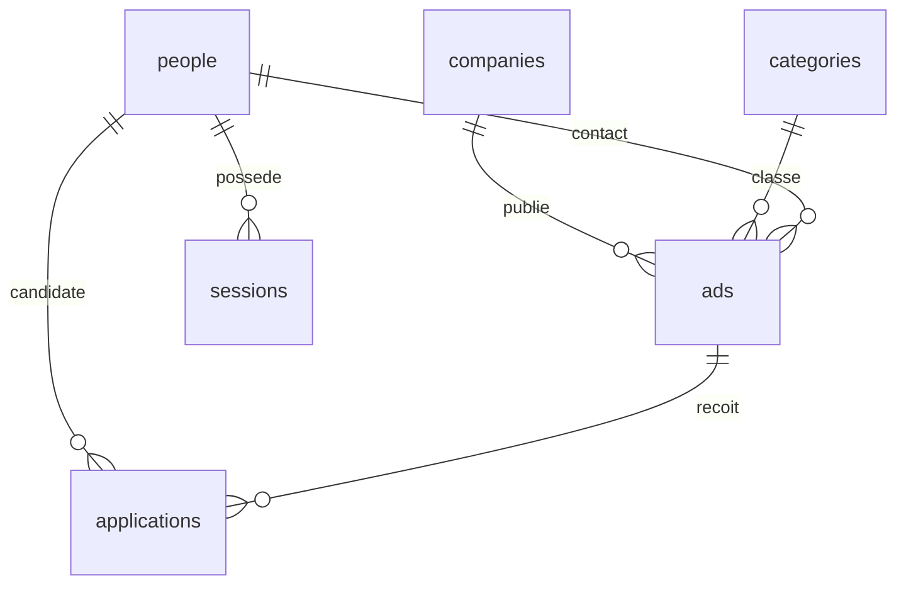

# HireLoop — Job Board

Application complète réalisée à partir des sujets **Job Board Bootstrap** et **Job Board Project** : frontend JavaScript, API REST Python et base relationnelle SQLite persistante.

## Démarrage en 30 secondes

Prérequis : **Python 3.10 ou supérieur**. Aucune installation de bibliothèque, aucun npm, aucune clé API ni connexion Internet nécessaire.

Depuis le dossier `jobboard` :

```sh
python server.py
```

Sous Windows, on peut aussi double-cliquer sur **`run.cmd`**. Le lanceur détecte `py`, puis le Python fourni avec Codex s'il existe, puis `python`.

Ouvrir **http://127.0.0.1:8000**. Garder le terminal ouvert ; `Ctrl+C` arrête le serveur.

Autre port :

```sh
python server.py --port 8080
```

La base est automatiquement créée dans `data/hireloop.sqlite3`, puis remplie **par le backend** uniquement au premier lancement. Les modifications restent enregistrées après un redémarrage.

### Comptes de démonstration

| Accès | E-mail | Mot de passe |
|---|---|---|
| Administrateur | `admin@hireloop.test` | `Admin2026!` |
| Candidate | `camille@hireloop.test` | `Camille2026!` |
| Candidat | `alex@hireloop.test` | `Alex2026!` |

Les entreprises, offres et personnes sont **fictives**. L'initialisation fournit 6 entreprises, 6 catégories, 12 offres, 3 personnes et 3 candidatures.

## Fonctionnalités

- Offres paginées, recherche par métier/mot-clé/entreprise, filtres par ville, domaine, contrat et organisation ; tri par pertinence, date ou salaire.
- Chaque offre présente un titre, un résumé, les conditions, un bouton **En savoir plus** et un bouton **Postuler**.
- Détail complet chargé avec `fetch()`, sans rechargement de document et sans popup. Les fragments d'URL `#job/1` rendent les vues partageables et compatibles avec le bouton Retour.
- Candidature anonyme (nom, e-mail, téléphone, message) ou avec un compte : les informations du compte sont automatiquement réutilisées.
- Conservation du message, de la date, de l'offre, du candidat et du statut. Les candidatures en double sont refusées.
- Inscription, connexion, déconnexion, modification du profil et du mot de passe ; suivi personnel des candidatures.
- Redirection après connexion : administrateur vers l'administration, candidat vers les offres.
- Administration protégée côté serveur : consultation, création, modification et suppression des **offres, entreprises, catégories, personnes et candidatures**. Formulaires avec listes de références et pagination des tables.
- Mise à jour du statut d'une candidature : reçue, en cours, entretien, acceptée ou refusée.
- Interface française responsive, navigation clavier, labels de formulaires, états vides, erreurs et confirmations intégrées.

**Réception des candidatures :** les messages sont enregistrés dans SQLite et visibles dans l'onglet Candidatures de l'administration. Il n'y a pas d'envoi SMTP ni de simulation d'envoi d'e-mail ; `email_status = Enregistré` indique uniquement la conservation du message. Aucun CV n'est demandé par le sujet et aucun téléversement n'est implémenté.

## Architecture

```text
jobboard/
  server.py              Serveur HTTP, API, validation et authentification
  schema.sql             Tables, clés étrangères, contraintes et index
  seed.py                Données fictives insérées par le backend
  run.cmd                Lanceur Windows
  public/
    index.html           Structure HTML et navigation
    style.css            Identité visuelle et responsive
    app.js               Vues, fetch, formulaires et administration
    favicon.svg          Icône locale
  tests/test_api.py      Tests d'intégration HTTP sur base temporaire
  docs/queries.sql       Les trois requêtes SQL du bootstrap
  docs/VALIDATION.md     Vérifications et parcours de démonstration
  data/                  Base et journaux locaux, exclus du livrable source
```

Le navigateur communique exclusivement avec `/api`. Le serveur utilise la bibliothèque standard Python (`http.server`, `sqlite3`, `hashlib`). SQLite est une véritable base SQL avec jointures, contraintes, transactions et stockage sur disque. La même origine sert l'API et les ressources statiques.

### Schéma relationnel



| Table | Principaux champs |
|---|---|
| `companies` | nom, secteur, ville, site, description, couleur |
| `categories` | nom unique |
| `people` | nom, e-mail unique, téléphone, mot de passe haché facultatif, rôle |
| `ads` | entreprise, catégorie, contact, titre, résumé, description, profil, ville, contrat, organisation, salaires, rythme, mise en avant, date |
| `applications` | offre, personne, message, statut, trace d'enregistrement, date ; unicité personne/offre |
| `sessions` | empreinte du jeton, personne, expiration |

Une candidature anonyme crée une personne sans mot de passe. Une adresse associée à un compte exige une connexion pour éviter l'usurpation. La création d'un compte avec une adresse déjà connue est refusée ; la récupération et la vérification par e-mail ne font pas partie de cette version locale.

Supprimer une offre ou une personne efface ses candidatures par cascade. Supprimer une entreprise, catégorie ou personne encore référencée comme contact d'une offre est refusé (`409`). Le dernier administrateur et la suppression de son propre compte sont protégés. La table technique `sessions` n'est pas exposée au CRUD pour éviter de divulguer les jetons.

## API REST

Toutes les routes sont préfixées par **`/api`**. Corps de requête en JSON avec `Content-Type: application/json`. Les réponses d'erreur ont la forme `{"error":"Explication"}`. Les listes sont généralement `{items,total,page,limit}` ; pagination `?page=1&limit=6`, limite maximale 100.

### Routes publiques et compte

| Méthode | Route | Fonction |
|---|---|---|
| GET | `/health` | Disponibilité de l'API et de SQLite |
| GET | `/ads` | Offres filtrées et paginées |
| GET | `/ads/:id` | Détail complet d'une offre |
| GET | `/companies/:id/ads` | Offres d'une entreprise |
| GET | `/meta` | Entreprises (ID/nom), catégories et villes pour les filtres |
| GET | `/stats` | Nombre d'offres, entreprises, personnes et candidatures |
| POST | `/ads/:id/applications` | Postuler, avec ou sans session |
| POST | `/auth/register` | Créer un compte candidat et ouvrir une session |
| POST | `/auth/login` | Ouvrir une session |
| POST | `/auth/logout` | Révoquer la session |
| GET | `/auth/me` | Compte courant ou `null` |
| PATCH | `/account` | Modifier son profil (session requise) |
| GET | `/my-applications` | Ses candidatures uniquement (session requise) |

Filtres `/ads` : `q`, `location`, `category_id`, `company_id`, `contract`, `work_mode`. Tri : `sort=relevant`, `sort=recent`, `sort=salary`. Les filtres se combinent avec ET ; recherche texte avec `LIKE` SQLite (la recherche des accents suit le comportement natif SQLite).

### CRUD administrateur

Pour chacune des ressources **`companies`, `categories`, `people`, `ads`, `applications`** :

| Méthode | Route | Fonction |
|---|---|---|
| GET | `/:resource` | Liste paginée |
| GET | `/:resource/:id` | Lire un enregistrement |
| POST | `/:resource` | Créer un enregistrement |
| PATCH | `/:resource/:id` | Modifier les champs fournis |
| PUT | `/:resource/:id` | Mettre à jour avec tous les champs obligatoires |
| DELETE | `/:resource/:id` | Supprimer un enregistrement |

Exception : la consultation des offres reste publique. Les autres opérations CRUD exigent une session administrateur, même si l'URL est saisie directement. Les listes de personnes ne renvoient jamais les empreintes de mot de passe.

Champs d'écriture : consulter `RESOURCES` et `REQUIRED` dans `server.py` ainsi que `schema.sql`. `id` et `created_at` sont gérés par le serveur. Un mot de passe facultatif peut être transmis lors du CRUD de personnes ; un compte sans mot de passe ne peut pas se connecter.

### Exemples curl

Sous PowerShell, employer `curl.exe` si `curl` désigne une commande PowerShell. Ces exemples sont écrits pour un terminal POSIX ; on peut aussi utiliser Postman ou Insomnia avec les mêmes corps JSON.

```sh
curl 'http://127.0.0.1:8000/api/ads?contract=CDI&location=Paris'
curl http://127.0.0.1:8000/api/ads/1
curl http://127.0.0.1:8000/api/companies/1/ads

curl -c cookies.txt -H 'Content-Type: application/json' \
  -d '{"email":"admin@hireloop.test","password":"Admin2026!"}' \
  http://127.0.0.1:8000/api/auth/login

curl -b cookies.txt -H 'Content-Type: application/json' \
  -d '{"company_id":1,"category_id":1,"contact_id":1,"title":"Développeur Python","summary":"Rejoignez notre équipe.","description":"Construire et maintenir notre API.","requirements":"Python et SQL.","location":"Paris","contract":"CDI","work_mode":"Hybride","salary_min":40000,"salary_max":50000}' \
  http://127.0.0.1:8000/api/ads

curl -H 'Content-Type: application/json' \
  -d '{"name":"Test Local","email":"test@example.test","phone":"0601020304","message":"Bonjour, je souhaite rejoindre votre équipe et contribuer à ce projet."}' \
  http://127.0.0.1:8000/api/ads/1/applications
```

Codes : `200` succès ; `201` création ; `400` données invalides ; `401` session absente/identifiants incorrects ; `403` accès administrateur refusé/origine invalide ; `404` ressource absente ; `405` méthode non autorisée ; `409` doublon/relation bloquante ; `413` corps trop grand ; `415` type de contenu incorrect ; `429` trop de tentatives de connexion.

## Tests et démonstration

```sh
python -m unittest discover -s tests -v
```

Les tests démarrent un serveur sur un port disponible et une base dans un dossier temporaire ; ils ne modifient pas les données de démonstration. Six scénarios couvrent plus de 100 requêtes HTTP : filtres, pagination, permissions anonymes/candidats, comptes, candidatures, validation, CRUD des cinq ressources, contraintes et origine des requêtes.

Voir `docs/VALIDATION.md` pour le parcours de soutenance. Les trois requêtes SQL demandées dans le bootstrap sont fournies dans `docs/queries.sql`.

## Configuration et limites de déploiement

- `JOBBOARD_DB` : chemin alternatif de base SQLite. Exemple PowerShell : `$env:JOBBOARD_DB='C:\temp\hireloop.sqlite3'` avant le démarrage.
- `--host` : adresse d'écoute, `127.0.0.1` par défaut. Le projet est livré pour une exécution locale.
- `COOKIE_SECURE=1` : ajoute l'attribut Secure aux cookies pour une installation derrière HTTPS ; ne pas activer en HTTP local.
- Mots de passe PBKDF2-HMAC-SHA256 (260 000 itérations et sel aléatoire), jetons de session aléatoires stockés sous forme d'empreinte SHA-256, cookies HttpOnly/SameSite=Lax, expiration 24 h, requêtes SQL paramétrées, contrôle d'origine, liste blanche des champs et politique CSP.
- La connexion est limitée à 15 tentatives par IP sur cinq minutes. Cette limitation en mémoire revient à zéro au redémarrage.
- Les comptes de démonstration et le serveur HTTP de la bibliothèque standard sont destinés au développement et à l'évaluation locale. Un déploiement Internet demande un serveur/reverse proxy adapté, HTTPS et le remplacement des comptes de démonstration. Aucune publication externe n'est effectuée.
- Aucun SMTP, récupération de mot de passe, vérification d'e-mail, stockage de CV ni collecte automatique d'offres externes n'est configuré. Le sujet détaillé est couvert par la gestion des offres dans l'administration.

Pour repartir de zéro, arrêter le serveur, sauvegarder puis déplacer `data/hireloop.sqlite3` (et les éventuels fichiers `-wal`/`-shm`) ; au prochain lancement une nouvelle base de démonstration sera créée.


## Administration du projet et des entreprises

Le rôle `admin` administre tout le projet. Le rôle `company_admin` est rattaché à une entreprise via `company_id` : il peut modifier sa fiche, créer/modifier/supprimer ses offres et consulter les candidatures reçues avec les coordonnées des candidats, puis modifier leur statut. Il ne peut pas gérer les comptes, les rôles ou les catégories. Les contrôles sont appliqués dans l’API, y compris sur les accès directs par identifiant. Les offres publiques restent visibles par tous.

Pour attribuer ce rôle : connectez-vous comme administrateur du projet, ouvrez **Administration → Personnes**, créez ou modifiez un compte, choisissez **Administrateur d’entreprise**, sélectionnez son entreprise et enregistrez. Pour un nouveau compte, renseignez un mot de passe afin de permettre la connexion. Plusieurs administrateurs peuvent être rattachés à la même entreprise.

Redémarrez le serveur après la mise à jour : la base existante est migrée automatiquement en conservant les comptes, les identifiants et les relations. L’administrateur existant conserve son accès global.
